 

  

Software engineer from Egypt with a backend focus. I've been coding and building since I was 12. I work across backend, frontend, mobile and cloud, and I lead the teams around it. B.Sc. in Computer and Control Systems Engineering from Mansoura University, Excellent with Honors (2025). Open to software engineering roles anywhere, remote or onsite.

| **16+** | **5,000+** | **2,357** | **978** |
|:---:|:---:|:---:|:---:|
| production systems I built and shipped | users across the platforms I built | event tickets issued by my ticketing platform | verifiable certificates issued by my credential platform |

## Stack

Also: WebSockets, OAuth2, LangChain, RAG, Zod, CockroachDB, Oracle Cloud.

## What I do

**Elyra, Founder.** A small team I started ([ElyraTeam](https://github.com/ElyraTeam)).
- [PopCors](https://popcors.com): EdTech platform with 900+ active users in the UAE and KSA. I'm the project lead and sole backend developer: payments, video streaming, course management, and the move from Cordova to Flutter.
- [ElyraGames](https://elyra.games/): realtime multiplayer games over WebSockets. 586+ rooms hosted, 32 completed games, 120+ players.
- Mozakrtna: study app with YouTube playlist tracking and a points system.

**[IEEE Mansoura](https://mansoura.ieee.org/), Webmaster (2022 to 2026).** Led 10+ engineers and shipped 16+ systems ([ieeemansb](https://github.com/ieeemansb)).
- OAuth2 identity for 483 volunteers across 13 committees.
- Recruitment platform: 1,584 applicants, 262 interviews, 4 cycles.
- Ticketing with Apple and Google Wallet passes and live scanning: 2,357 tickets.
- IEEE Victoris, registration to judging: 3,700+ users over seasons 2 to 5.
- RAG rule checker (LangChain, Gemini) for team eligibility. Credential platform: 978 certificates.

**[IEEE Young Professionals Egypt](https://ieeeypegypt.org/), Webmaster (Feb 2026 to now).**
- Run the organization's website, built on WordPress.
- Maintain the technical systems behind it.

**[CAT Reloaded](https://catreloaded.org/), Team Coordinator (2023 to 2024).** Mansoura University tech community.
- Coordinated 17 circles (5 non-technical, 12 technical) with 700+ members.
- Delivered 4 events with 1,960 registrations: OWASP x CAT Reloaded, CATalyst 1.0, CAT Scope 24 and Hello World 9.
- Ran recruitment (1,084 applicants, 484 accepted) and revived the PodCAT podcast, which reached 28,891 views in its first year back.
- Before that: Flutter Circle Head (led 40+ members, built a QR-based attendance system) and CAT App Project Manager.

**Mansoura University, Teaching Assistant (Oct 2025 to Jun 2026).**
- Led weekly labs for 3 courses: data structures and algorithms, computer graphics, digital control systems.
- Built Python pipelines for handwritten Arabic attendance sheets (fuzzy name matching) and grade processing.

## Public work

- [zod-express-validator](https://github.com/HossamMohsen7/zod-express-validator): my npm package that validates Express requests and responses with Zod schemas.
  
  
  
- [express-typescript-template](https://github.com/HossamMohsen7/express-typescript-template): the Express and TypeScript backend template I start new projects from.
- [ElyraGames backend](https://github.com/ElyraTeam/minigames-backend) and [web client](https://github.com/ElyraTeam/minigames-web): the realtime game server and frontend behind elyra.games.
- [CashWise](https://github.com/CashWiseProject): graduation project (A+). I led a team of 10 across backend, AI and mobile: multi-wallet finance app with OCR receipts ([Receipt-OCR](https://github.com/CashWiseProject/Receipt-OCR)), voice input, an AI chatbot and WebSocket sync.
- [ALLaM Challenge](https://github.com/Allam-Future-Makers): national finalist in Riyadh, with a Flutter app and a multimodal ReAct agent using RAG on SDAIA's Arabic LLM.
- [Spectra Mappers](https://github.com/SpectraMappers) (NASA Space Apps 2024, Landsat data).

Reach me at <a href="mailto:hossam@hossamohsen.me">hossam@hossamohsen.me</a>, on <a href="https://linkedin.com/in/hossammohsen">LinkedIn</a> or <a href="https://twitter.com/HossamMohsen77">Twitter</a>.

